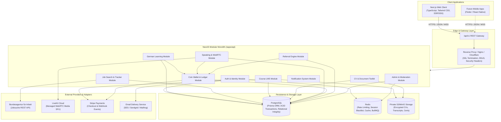
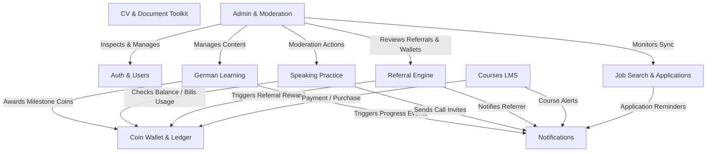

# Ausbildung Preparation Portal — System Architecture

## 1. Architectural Philosophy: The Modular Monolith
To maximize development velocity, maintain strict transaction boundaries, minimize operational overhead, and avoid the premature distributed systems complexity of microservices, the backend is architected as a **Modular Monolith** using NestJS and TypeScript.

Every business domain (Auth, Learning, Jobs, Toolkit, Courses, Speaking, Coins, Referrals, Admin) is encapsulated in its own NestJS module with explicit public service contracts and strict DTO boundaries. Should specific modules (e.g., WebRTC signaling or Job Crawler queues) require independent scaling in the future, their clean modular boundaries permit extraction without altering consumer contracts.

---

## 2. Module Dependency Matrix & Invariants

### Critical Architectural Invariants
1. **Ledger Decoupling:** Modules that trigger rewards (Learning, Referral, Admin) never alter wallet balances directly; they interact exclusively via transactional wallet methods (`reserveFunds`, `commitReservation`, `creditReward`, `processPayment`).
2. **No Direct Model Leaks:** Services never return raw database entities across network boundaries. All controller payloads strictly use versioned Data Transfer Objects (DTOs) with class-validator validation.
3. **Storage Isolation:** User-submitted binary files (PDFs, images) are never stored in the database or public web directories. They reside in private object storage, accessed only via short-lived, pre-signed authorization URLs generated on-demand.
4. **Provider Adapter Abstraction:** External dependencies (Job search, Payments, WebRTC, Object storage, Email) are strictly abstracted behind TypeScript interfaces. Mock adapters are supplied for offline and local test environments.

---

## 3. Layered Responsibilities
| Layer | Scope and Constraints |
| :--- | :--- |
| **Frontend Presentation (`apps/web`)** | Next.js with React 19 / TypeScript and Tailwind CSS. Responsible for responsive UI rendering, internationalized text catalogs (Bengali, English, German), client-side optimistic updates, accessible interactive controls, and visual states (loading, error, empty). Never calculates financial costs or authorization credentials. |
| **API Gateway & Routing (`apps/api`)** | NestJS Controllers with prefix `/api/v1`. Enforces global guards: JWT authentication, RBAC authorization, security headers, CORS origin allowlists, request throttling, and correlation IDs (`X-Correlation-ID`). |
| **Business Logic (`apps/api/src/modules`)** | NestJS Services. Executes domain rules, validates business constraints, processes idempotency keys, manages atomic transactions, and coordinates asynchronous events. |
| **Data Access Layer** | Prisma ORM mapping to PostgreSQL. Schema maintains explicit foreign keys, indexes, check constraints, unique constraints, and transaction isolation levels. |
| **Realtime Communication** | Managed WebRTC provider (LiveKit SFU) handles peer media routing. NestJS backend coordinates session signaling, room creation, server-side participant permission grants, and short-lived JWT token issuance. |
| **Background Processing** | BullMQ backed by Redis for asynchronous tasks: external job sync polling, email dispatch, notification fanout, streak calculations, and referral fraud evaluations. |
