# Ausbildung Preparation Portal — Phase-by-Phase Development Roadmap

## Phase Overview & Sequencing

```mermaid
gantt
    title Ausbildung Preparation Portal Implementation Sequence
    dateFormat  X
    axisFormat  Day %d
    section Foundation
    Phase 0 - Audit, Architecture & Planning   :active, p0, 0, 1
    Phase 1 - Monorepo, Web Foundation & UI     :p1, after p0, 2
    Phase 2 - Database, Auth & Security        :p2, after p1, 2
    section Core Features
    Phase 3 - Multilingual German Learning     :p3, after p2, 3
    Phase 4 - Live Job Search & Applications   :p4, after p3, 3
    Phase 5 - Free & Paid LMS Courses          :p5, after p4, 2
    section Application & Community
    Phase 6 - CV, Documents & Toolkit          :p6, after p5, 2
    Phase 7 - Speaking Partners & WebRTC Calls :p7, after p6, 3
    Phase 8 - Coin Ledger, Tasks & Referrals   :p8, after p7, 3
    section Administration & Hardening
    Phase 9 - Dashboards & Administration      :p9, after p8, 2
    Phase 10 - Security, QA & Performance      :p10, after p9, 2
    Phase 11 - Operations, Mobile-API Readiness:p11, after p10, 2
```

---

## Detailed Phase Breakdown

### Phase 0: Project Audit, Architecture & Invariants (CURRENT)
- **Goal:** Comprehensive workspace audit, system architecture, database ERD, API schema, threat modeling, and development roadmap.
- **Deliverables:** Architectural specifications in `docs/`, repository structure initialized with `.gitignore`, `package.json`, `docker-compose.yml`, and `.env.example`.
- **Exit Criteria:** Architecture approval from the user before writing application code.

### Phase 1: Foundation, Design System & Public Website
- **Goal:** Set up Next.js frontend with Tailwind CSS, professional German educational identity, and public landing pages.
- **Pages:** Home, About, German Learning Overview, Job Search Preview, Courses Preview, Speaking Community Overview, Pricing & Coins, FAQ, Contact, Privacy, Terms, Community Guidelines.
- **Localization:** Bengali, English, and German language switcher.
- **Exit Criteria:** Responsive public pages render seamlessly with dark/light theme support, accessible navigation, and zero console errors.

### Phase 2: Database, Authentication & User Security
- **Goal:** Set up PostgreSQL with Prisma ORM and NestJS authentication module.
- **Deliverables:** User registration, email verification, login/logout, password reset, session refresh token rotation, RBAC guards (`STUDENT`, `ADMIN`), and Swagger documentation.
- **Exit Criteria:** Integration tests pass for credential flows, password hashing, and role protection.

### Phase 3: Multilingual German Learning Platform
- **Goal:** Educational engine covering CEFR levels A1 through B2.
- **Deliverables:** Module and lesson navigation, grammar guides, vocabulary with audio/IPA, interactive exercises, server-evaluated quizzes, and progress streaks.
- **Exit Criteria:** Quiz scoring executed exclusively on backend; progress persisted reliably.

### Phase 4: Live Ausbildung Job Search & Tracker
- **Goal:** Live query adapter for German Federal Employment Agency (`jobsuche.api.bund.dev`).
- **Deliverables:** Keyword/city/profession search, filterable lists, deduplication, job bookmarking, and multi-stage Kanban application tracker (`PLANNED` -> `APPLIED` -> `INTERVIEW`, etc.).
- **Exit Criteria:** Real job listings returned from Bundesagentur API or clean fallback to verified demo data with error diagnostics.

### Phase 5: Free and Paid Courses LMS
- **Goal:** Specialist training courses (e.g., Nursing German, Technical German, German Workplace Culture).
- **Deliverables:** Course catalog, video/text lessons, enrollment tracking, certificate generation, and Stripe checkout integration with idempotent webhooks.
- **Exit Criteria:** Paid courses unlock only after server-verified webhook confirmation.

### Phase 6: CV, Cover Letter & Application Toolkit
- **Goal:** German Bewerbungsunterlagen builder conforming to DIN 5008 standards.
- **Deliverables:** Multi-version CV generator, Anschreiben creator, private document vault (S3/MinIO) with pre-signed download URLs, and interview checklists.
- **Exit Criteria:** Exportable, well-formatted German CV PDF; secure file access controls.

### Phase 7: Speaking Partners & Audio/Video WebRTC Calls
- **Goal:** Consent-driven peer language practice with WebRTC.
- **Deliverables:** Granular speaking profile and gender preferences, matching engine, request/accept workflow, LiveKit room token generator, and call usage recording.
- **Exit Criteria:** Bidirectional consent verified before token issuance; user blocking and reporting fully operational.

### Phase 8: Coin Wallet, Rewards, Tasks & Referrals
- **Goal:** Integer-based virtual coin economy and ledger.
- **Deliverables:** Double-entry ledger, balance reservations for calls, server-verified milestone reward tasks, and fraud-resistant referral engine.
- **Exit Criteria:** Concurrency-safe ledger transactions preventing double-spending and negative balances.

### Phase 9: Unified Dashboards & Administration
- **Goal:** Centralized operational cockpit for users and administrators.
- **Deliverables:** Student progress hub, admin moderation queues, user management, audit logs, and operational sync health monitoring.
- **Exit Criteria:** Least-privilege role boundaries tested; sensitive actions strictly audited.

### Phase 10: Security, Quality & Performance Hardening
- **Goal:** Deep security review and end-to-end stress testing.
- **Deliverables:** Penetration test checklists (IDOR, CSRF, XSS, SSRF), rate-limiting verification, database index optimization, and Playwright E2E suites.
- **Exit Criteria:** Zero high-severity vulnerabilities; all automated test suites passing.

### Phase 11: Deployment, Operations & Future Mobile App Readiness
- **Goal:** Production staging setup, backup validation, and mobile API contracts.
- **Deliverables:** CI/CD workflows, staging deployment runbooks, database recovery drills, and OpenAPI SDK export for Flutter/React Native.
- **Exit Criteria:** Clean production builds; validated disaster recovery drill; decoupled API contracts.
