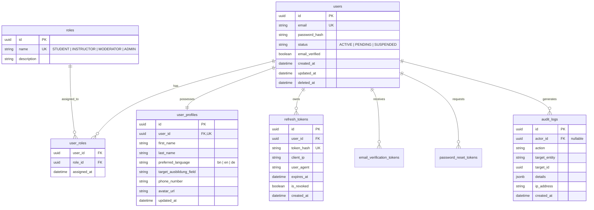
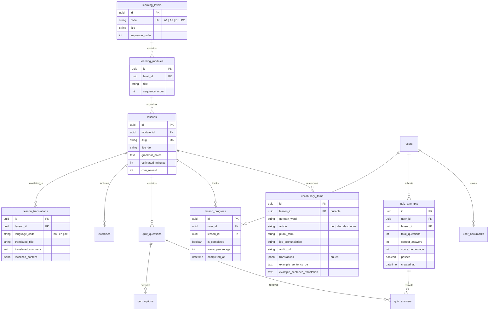
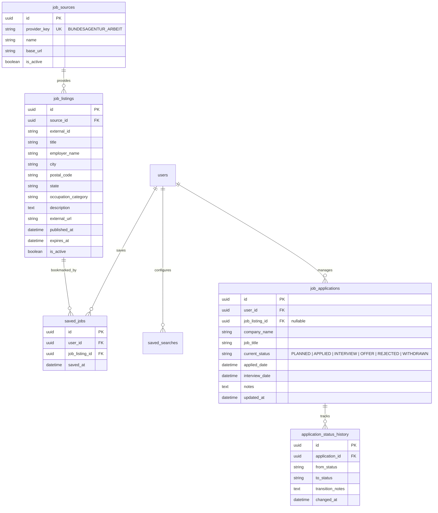
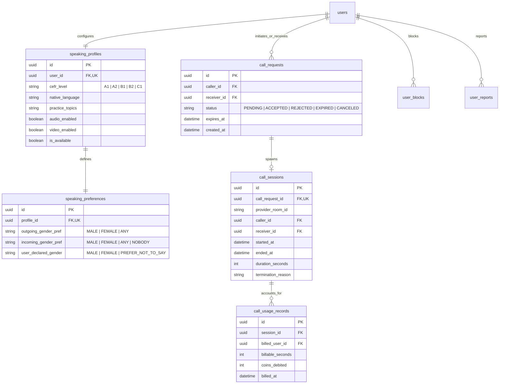
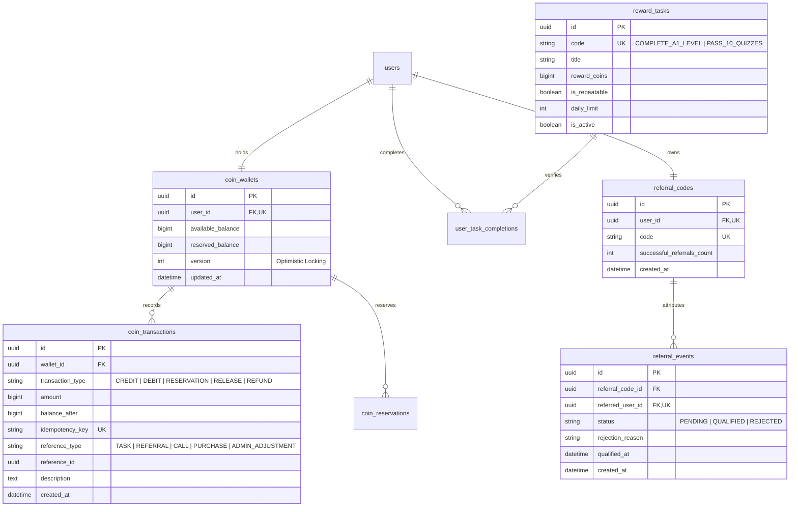

# Ausbildung Preparation Portal — Entity-Relationship Diagrams (ERD)

## 1. Identity, Authentication & Security ERD

---

## 2. German Learning Curriculum ERD

---

## 3. Job Search & Application Tracker ERD

---

## 4. Speaking Practice & WebRTC Session ERD

---

## 5. Coin Economy, Ledger & Referrals ERD

